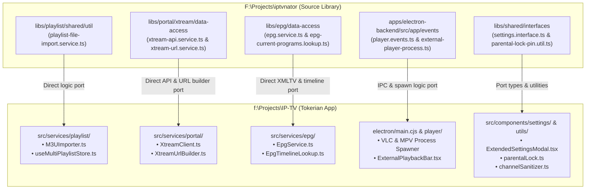

# Tokerian: Master Architecture & IPTVnator Feature Integration Plan

> **Application**: **Tokerian** (Live Television, VOD & Series Hub)  
> **Target Platforms**: Web, Desktop (Electron for Windows/macOS/Linux), Android Mobile & Android TV (Capacitor with D-Pad Leanback)  
> **Source Clone**: [`F:\Projects\iptvnator`](file:///F:/Projects/iptvnator) (Open-source IPTV client)  
> **Architecture**: Hexagonal Ports & Adapters + TypeScript + Zustand + Pure Vanilla CSS Design System  
> **Extraction Strategy**: Reusing and porting core modules, services, types, and logic directly from `F:\Projects\iptvnator` into Tokerian.

---

## 1. System Architecture & Module Extraction Map



---

## 2. Core Reusable Assets from IPTVnator

| Domain | IPTVnator Source Location | Tokerian Target File | Extracted Functionality |
| :--- | :--- | :--- | :--- |
| **M3U Import & Parsing** | `libs/playlist/shared/util/src/lib/playlist-file-import.service.ts` | [`src/services/playlist/M3UImporter.ts`](file:///f:/Projects/IP-TV/src/services/playlist/M3UImporter.ts) | Local file reading, `#EXTINF` tag extraction (`tvg-id`, `tvg-logo`, `group-title`, `catchup`), URL imports. |
| **Xtream Codes API** | `libs/portal/xtream/data-access/src/lib/services/xtream-api.service.ts` | [`src/services/portal/XtreamClient.ts`](file:///f:/Projects/IP-TV/src/services/portal/XtreamClient.ts) | `/player_api.php` authentication, category fetching, Live, VOD Movies, and TV Series stream discovery. |
| **Xtream URL Generation** | `libs/portal/xtream/data-access/src/lib/services/xtream-url.service.ts` | [`src/services/portal/XtreamUrlBuilder.ts`](file:///f:/Projects/IP-TV/src/services/portal/XtreamUrlBuilder.ts) | Constructing direct stream URLs for Live (`.m3u8`/`.ts`), Movies (`.mp4`/`.mkv`), and Series episodes. |
| **EPG / XMLTV Guide** | `libs/epg/data-access/src/lib/` & `channel-epg-lookup.util.ts` | [`src/services/epg/EpgService.ts`](file:///f:/Projects/IP-TV/src/services/epg/EpgService.ts) | XMLTV (`.xml`/`.xml.gz`) parser, channel ID matching, live program progress percentage calculation. |
| **Desktop External Players** | `apps/electron-backend/src/app/events/player.events.ts` | [`electron/main.cjs`](file:///f:/Projects/IP-TV/electron/main.cjs) | Spawning **VLC** (`vlc.exe`) and **MPV** (`mpv.exe`) with stream URL, headers, and window tracking. |
| **Parental Lock PIN** | `libs/services/src/lib/parental-lock/` | [`src/utils/parentalLock.ts`](file:///f:/Projects/IP-TV/src/utils/parentalLock.ts) | 4-digit PIN SHA-256 hash validation, locked categories concealment, and configurable relock timeout. |
| **Title Sanitization** | `libs/shared/interfaces/src/lib/channel-title.util.ts` | [`src/utils/channelSanitizer.ts`](file:///f:/Projects/IP-TV/src/utils/channelSanitizer.ts) | Stripping country prefixes (`"US | "`, `"UK - "`, `"IN: "`) for clean channel titles. |

---

## 3. Directory Structure with Imported Modules

```text
f:\Projects\IP-TV\
├── electron/
│   ├── main.cjs                         # Enhanced with VLC & MPV child_process spawner
│   └── preload.cjs                      # Exposes window.electron.openVlc / openMpv
│
├── src/
│   ├── services/
│   │   ├── playlist/                    # Ported from IPTVnator libs/playlist
│   │   │   ├── M3UImporter.ts           # Local file reader, URL fetcher & raw text parser
│   │   │   └── PlaylistStorage.ts       # Multi-playlist IndexedDB storage
│   │   ├── portal/                      # Ported from IPTVnator libs/portal/xtream
│   │   │   ├── XtreamClient.ts          # player_api.php authentication & catalog queries
│   │   │   └── XtreamUrlBuilder.ts      # Live, VOD, and Series streaming URL constructor
│   │   └── epg/                         # Ported from IPTVnator libs/epg
│   │       ├── EpgService.ts            # XMLTV parser & program lookup
│   │       └── EpgTimeline.ts           # "Now Playing" & "Next Up" progress calculation
│   │
│   ├── stores/
│   │   ├── useChannelStore.ts           # Active channels catalog & filtering
│   │   ├── useMultiPlaylistStore.ts     # Multi-playlist manager & active source switcher
│   │   ├── usePlayerStore.ts            # Playback state, audio/subtitle tracks, OSD timers
│   │   ├── useEpgStore.ts               # Program guide data cache & channel schedule map
│   │   └── useSettingsStore.ts          # Application settings & parental controls
│   │
│   ├── components/
│   │   ├── playlist/
│   │   │   ├── AddPlaylistModal.tsx     # 3 Tabs: Tokerian Free TV, M3U (File/URL), Xtream Codes
│   │   │   └── PlaylistManagerModal.tsx # Manage, rename, auto-refresh, and delete playlists
│   │   ├── epg/
│   │   │   ├── EpgRibbon.tsx            # Live progress bar under player & channel cards
│   │   │   └── EpgGridModal.tsx         # Multi-channel program guide timeline
│   │   ├── vod/
│   │   │   ├── VodCatalog.tsx           # Movies & Series grid with category filters
│   │   │   └── VodDetailModal.tsx       # Synopsis, cast, duration, and "Continue Watching"
│   │   ├── player/
│   │   │   └── VideoPlayer.tsx          # With external player buttons (VLC/MPV) & EPG ribbon
│   │   ├── settings/
│   │   │   └── ExtendedSettingsModal.tsx# General, Playback, External Player, EPG, Parental Lock
│   │   └── command/
│   │       └── CommandPalette.tsx       # Ctrl+K global search & action launcher
│   │
│   └── utils/
│       ├── parentalLock.ts              # PIN hashing & category filter
│       └── channelSanitizer.ts          # Country prefix cleaner
```

---

## 4. Phased Implementation Roadmap

### Phase 1: Multi-Playlist Engine & M3U / Xtream Import (COMPLETED)
- [x] Install `iptv-playlist-parser` and parser dependencies.
- [x] Port `M3UImporter.ts` (File drag-and-drop, remote URL, raw text paste).
- [x] Port `XtreamClient.ts` & `XtreamUrlBuilder.ts` (Authentication, categories, live streams, movies, and series).
- [x] Implement `useMultiPlaylistStore.ts` with IndexedDB persistence for switching between playlists.
- [x] Build `AddPlaylistModal.tsx` and `PlaylistManagerModal.tsx` in UI.

### Phase 2: Electronic Program Guide (EPG / XMLTV) Engine (COMPLETED)
- [x] Install `epg-parser` and port XMLTV parser logic from `libs/epg`.
- [x] Implement `EpgService.ts` matching channels by `tvg-id`, `tvg-name`, or channel name.
- [x] Build `EpgRibbon.tsx` displaying "Now Playing" and "Next Up" with a live progress percentage bar.
- [x] Build `EpgGridModal.tsx` multi-channel timeline schedule matrix.

### Phase 3: Desktop External Players (VLC & MPV via Electron) (COMPLETED)
- [x] Port `external-player-process.ts` logic into `electron/main.cjs`.
- [x] Auto-detect standard Windows paths for `vlc.exe` and `mpv.exe`.
- [x] Expose `openVlc` and `openMpv` in `electron/preload.cjs`.
- [x] Add "Open in VLC" and "Open in MPV" options in the video player OSD and channel menu.

### Phase 4: VOD (Movies) & TV Series Catalog (COMPLETED)
- [x] Add **Live TV**, **Movies**, and **Series** view toggle in header/navigation.
- [x] Implement `VodCatalog.tsx` with category filters, poster cards, and sorting (name, rating, date).
- [x] Build `VodDetailModal.tsx` with synopsis, episode selector, and "Resume Watching" timestamp tracking.

### Phase 5: Extended Settings, Parental Lock & Command Palette (`Ctrl+K`) (COMPLETED)
- [x] Port Parental Lock PIN verification and category hiding (`parentalLock.ts`).
- [x] Implement Country Prefix Cleaner toggle (`channelSanitizer.ts`).
- [x] Upgrade Settings modal into a tabbed preferences center (General, Playback, External Players, Title Cleaner, Parental Lock).
- [x] Implement `CommandPalette.tsx` accessible via `Ctrl+K` for global search and navigation.

---

## 5. Verification & Testing Standards
1. **Compilation**: `npm run build:web` must compile with 0 TypeScript/build errors after every phase.
2. **Multi-Platform Sync**: `npx cap sync android` must sync web dist assets to Android seamlessly.
3. **Desktop Executable**: `npm run build:desktop` packages the standalone Windows `.exe` installer.
4. **Responsive UI**: All newly added dialogs, grids, and ribbons must adhere to the pure Vanilla CSS cinema dark design system and remain fully touch-responsive on small screens and TV D-pad compatible.
